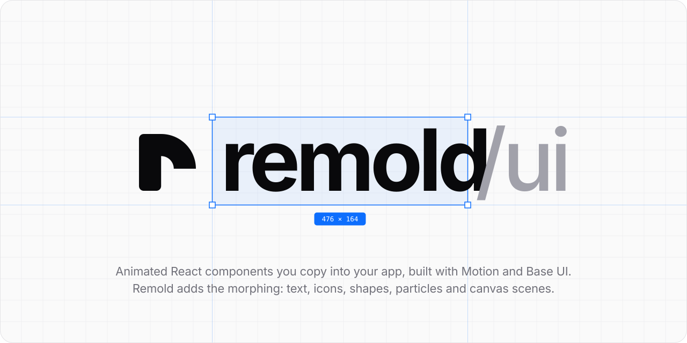

<div align="center">

<picture>
  <source media="(prefers-color-scheme: dark)" srcset=".github/assets/hero-dark.svg">
  
</picture>

<br />
<br />

[](https://github.com/albertdugba/remold-ui/actions/workflows/ci.yml)
[](LICENSE)


**Change you can follow.**

Morphing for the web: text, icons, SVG paths and layouts that reshape into what comes next,<br />
lines that stay attached while things move, and particles that re-form from one shape into another.

</div>

---

## What Remold is

Two things, kept apart on purpose:

- **A library** (`@remold-ui/*`) for morphing and for following changes on a page. The core is plain TypeScript, with React bindings and a plain-JavaScript API for everything else.
- **Copy-in components** on the docs site. They're ordinary React components and they use more than Remold: [Base UI](https://base-ui.com) for behaviour and accessibility, [Motion](https://motion.dev) for most of the springs, enter and exit animations and shared-element moves, and Remold for the morphing, the connector lines and the particles.

If you need springs and enter and exit animations, Motion on its own is the right tool. Remold is for the moments when one thing turns into another.

## What it does

### Morphing

When a change swaps one thing for another, Remold reshapes the old one into the new one, so people can see what became what.

- **Text.** `Remold.Text` and `morphText()` turn "Saving" into "Saved" letter by letter: shared letters slide into place and the rest fade. It stays real, selectable text for screen readers.
- **Icons.** `Remold.Icon` reshapes the strokes of one icon into the next, from any icon set (Hugeicons, Lucide, your own) or from path data, and keeps the icon's own fill and stroke.
- **SVG paths and illustrations.** `createMorph()` and `Remold.PathGroup` pair up the subpaths of two shapes on their own, so a logo can become another logo, or a cooking pot a delivery bag. `@remold-ui/morph` is the same engine on its own, for Motion, GSAP or your own clock.
- **Layouts.** `Remold.Layout` and `transition()` read the page before and after a change and pair elements by what they show, with no ids to add. Only what changed moves.

### Connectors

`Remold.Connectors` and `Remold.Anchor` draw lines between elements that stay attached while those elements move. Lines draw in and out and can carry pulses, for comment threads, course outlines, product tours and step progress.

### Particles and canvas

`Remold.Particles`, `Remold.DotGrid`, `Remold.Globe` and `Remold.Scene` are live canvas pieces: point clouds that re-form from one shape into the next with no keys to match, dot grids that answer the cursor, a dotted globe, and isometric scenes whose layouts spring between each other.

### Around all of it

- **Any framework.** The core has no browser code. On top of it are React bindings and a DOM API for Vue, Svelte, Angular, Solid or no framework at all. It reads what's already rendered, so it sits alongside Base UI, React Aria, Radix, MUI or your own components.
- **Reduced motion and assistive tech.** It follows `prefers-reduced-motion`, morphing text stays real text, and focus survives elements being replaced.

## Quick start

> Remold hasn't had its first npm release yet. Until it does, clone the repo and use the workspace packages (see [Development](#development)).

### React

```bash
npm install @remold-ui/react
```

```tsx
import { Remold } from "@remold-ui/react";

export function Tasks({ tasks, sort }) {
  // Re-sorting moves each row from where it was to where it is now. Remold matches rows by what
  // they show, so it needs no ids of its own (the key is only there for React).
  return (
    <Remold.Layout trigger={sort}>
      {tasks.map((task) => (
        <TaskRow key={task.id} task={task} />
      ))}
    </Remold.Layout>
  );
}

export function SaveLabel({ saving }) {
  // "Saving" becomes "Saved" letter by letter: the shared letters stay put.
  return <Remold.Text>{saving ? "Saving" : "Saved"}</Remold.Text>;
}

export function MenuButton({ open }) {
  // The menu icon's strokes reshape into the close icon.
  return <Remold.Icon icon={open ? <CloseIcon /> : <MenuIcon />} />;
}
```

### Plain JavaScript, or any framework

```bash
npm install @remold-ui/dom
```

`transition()` takes an element and a function that changes what's inside it. Remold reads the page before and after, and moves what moved.

```js
import { morphText, transition } from "@remold-ui/dom";

// Change the DOM however you like: replaceChildren, innerHTML, a template.
transition(list, () => {
  list.replaceChildren(...sortBy(tasks, "a–z").map(renderRow));
});

morphText(statusLabel, "Saved");
```

The change can be async, which is how it works with frameworks that render on their own schedule. Change the state, then wait for the framework to update the page:

```js
// Vue
transition(list, async () => {
  sort.value = "a–z";
  await nextTick();
});

// Svelte
transition(list, async () => {
  sort = "a–z";
  await tick();
});
```

## Primitives

| React | Plain JavaScript | What it does |
| --- | --- | --- |
| `Remold.Layout` | `transition()` | Animates everything that moved, resized, appeared or left. It matches elements by what they show, so it works even when each view has different markup. |
| `Remold.Text` | `morphText()` | Morphs text letter by letter: shared letters slide, the rest fade. |
| `Remold.Icon` | `iconToPath()` + `createMorph()` | Reshapes one icon into another, from any icon set or from path data. |
| `Remold.Connectors` + `Remold.Anchor` | `connectors()` | Draws lines between elements that stay attached while they move. Lines draw in and out, and pulses run along them. |
| `Remold.PathGroup` | `createMorph()` | Morphs a set of paths together, for illustrations and logos. |
| `Remold.Scene` · `Remold.Canvas` | `scene()` · `painter()` | Live canvas scenes: an isometric camera and layouts that spring between each other. |
| `Remold.Particles` · `Remold.DotGrid` · `Remold.Globe` | `particles()` · `dotGrid()` · `globe()` | Point clouds that re-form from one shape into the next, with no keys to match. |
| `Remold.Story` | | Plays a sequence of states on one shared clock. |
| `Remold.Ignore` | `data-rm-ignore` | Leaves part of the page out of matching. |

The JavaScript functions come from `@remold-ui/dom`, `@remold-ui/canvas` and `@remold-ui/morph`.

React hooks: `useRemold()` for interactive changes that may be interrupted, `useViewTransition()` for page-sized changes (with the View Transitions API where the browser has it), plus `useAutoplay`, `useSpringPress`, `useDragToDismiss` and `useConnectorMotion`.

## Components

The docs site has around 55 copy-in components. Each one solves a specific product problem and animates only the change that matters. They're React components that depend on `motion` and `@base-ui/react` as well as Remold; every page has a shadcn registry install command that copies the code and CSS into your project and adds what it needs.

| | |
| --- | --- |
| **Interface** | API keys · Bulk selection · Cards · Command palette · Comment thread · Course outline · Currency converter · Event RSVP · Filter bar · Fluid popover menu · Hold to record · Invite teammates · Kitchen ticket · Label picker · Live room · Logo morph · Mentions · Morph icons · Music player · Onboarding checklist · One-time code · Price filter · Product tour · Project setup · Revenue · Save button · Seat calculator · Send a message · Send money · Share link · Signature · Step progress · Streak · Table booking · Task list · Two-factor setup · Usage meter · Wallet |
| **Form elements** | Address autocomplete · Amount input · Phone input · Promo code · Quantity stepper · Range slider · Split amount · Tag input · Upload row |
| **Illustrations** | Order tracker |
| **Particles and canvas** | Donation goal · Dot grid hero · Focus timer · Inbox triage · Live visitors · Particles story · Unit chart · Voice orb |

## Packages

| Package | |
| --- | --- |
| [`@remold-ui/core`](packages/core) | Shapes, morphing, matching and layout. Pure maths with no DOM, on purpose. |
| [`@remold-ui/dom`](packages/dom) | Reads what's on screen (elements, SVG, canvas) into plain data, and plays transitions. |
| [`@remold-ui/react`](packages/react) | React components and hooks. |
| [`@remold-ui/vue`](packages/vue) | Vue adapter. Early: for now, use `@remold-ui/dom` from Vue, as in the quick start. |
| [`@remold-ui/angular`](packages/angular) | Angular adapter. Early: for now, use `@remold-ui/dom` from Angular. |
| [`@remold-ui/canvas`](packages/canvas) | Live canvas scenes, looks and keyless point clouds. |
| [`@remold-ui/morph`](packages/morph) | Framework-neutral SVG path matching and interpolation, for Motion, GSAP or your own renderer. |

Every package is versioned together, ships ESM and CommonJS with types, and is free of side effects so it tree-shakes.

## Development

Requires Node 22.12 or newer and pnpm 10.

```bash
pnpm install     # once
pnpm dev         # builds the packages and starts the docs, with every component live
pnpm test        # every package's tests
pnpm typecheck   # every package, strict
pnpm lint        # Biome
pnpm build       # everything; Turborepo skips what hasn't changed
```

```text
packages/
  core/      headless maths: shapes, morphing, matching
  dom/       the browser layer
  react/     React components and hooks
  vue/       Vue adapter (early)
  angular/   Angular adapter (early)
  canvas/    canvas scenes and particles
  morph/     standalone SVG path morphing
apps/
  docs/      documentation and every component, live
```

## CI and releases

Every pull request and every push to `main` runs [CI](.github/workflows/ci.yml), four jobs in parallel:

| Job | Checks |
| --- | --- |
| **lint** | Biome across the whole repo. |
| **typecheck** | Every package and the docs, with Turborepo's cache. |
| **test** | Every package's Vitest suite. |
| **build-and-package** | Builds everything, then checks that every file each package exports is really there. |

Releases use [Changesets](https://github.com/changesets/changesets):

1. Add a changeset with each user-facing change: `pnpm changeset`.
2. [Version packages](.github/workflows/version-packages.yml) opens a pull request that bumps every package together.
3. Pushing a `vX.Y.Z` tag runs [Publish packages](.github/workflows/publish.yml). It checks the tag matches the version, reruns the full checks, and publishes every package to npm.

The details are in [RELEASING.md](RELEASING.md).

## Contributing

Issues and pull requests are welcome.

- **Keep the change focused.** Add a changeset if users will notice it.
- **Run the checks before you push:** `pnpm lint && pnpm typecheck && pnpm test`. Husky lints your staged files on commit.
- **Components solve a specific problem.** Animate the one change that matters, and leave the rest still.

## Built with

The components lean on [Base UI](https://base-ui.com) for behaviour and accessibility, [Motion](https://motion.dev) for springs and shared-element animation, and [Hugeicons](https://hugeicons.com) for icons. The currency converter's rates come from [ExchangeRate-API](https://www.exchangerate-api.com).

## License

[MIT](LICENSE) © Albert Dugba
